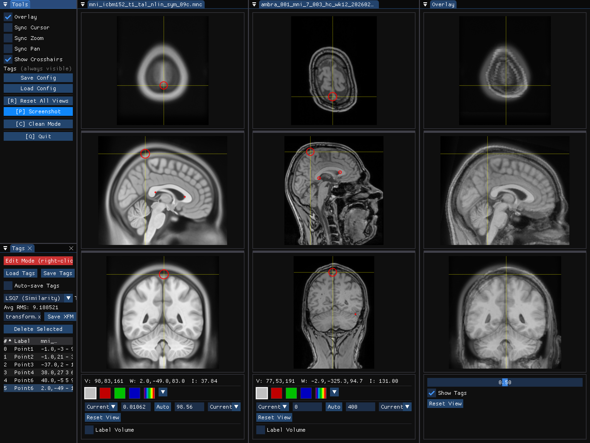
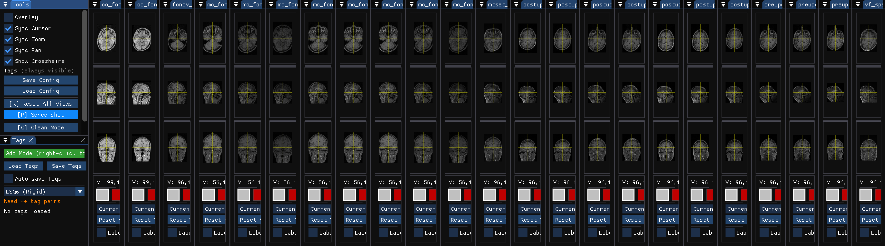
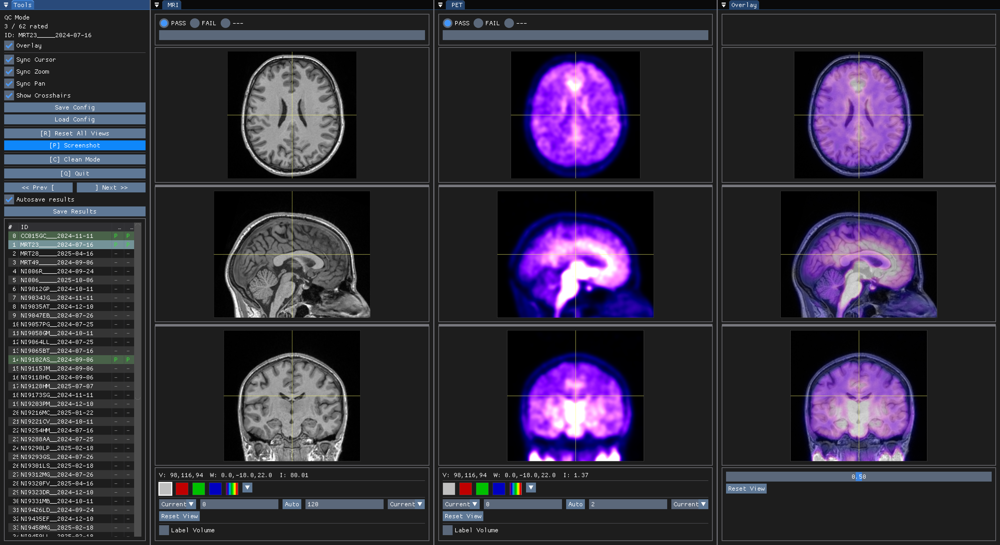

# Neuro Slop for the Neuro Science

## 100% Vibe coded register replacement, C++17 , Vulkan with OpenGL2 fallback (Metal on macOS), ImGui

Now you can open as many MRI scans at once, as your nice 50" monitor allows you

There is also a special QC mode

Original register (human coded 1993-2024): https://github.com/BIC-MNI/register , original documentation: https://en.wikibooks.org/wiki/MINC%2FVisualTools%2Fregister

Build instructions, command-line usage, configuration and QC-mode docs: [new_register/README.md](new_register/README.md).

See [PLAN.md](PLAN.md) for planned improvements and enhancements.

**YMMV!**